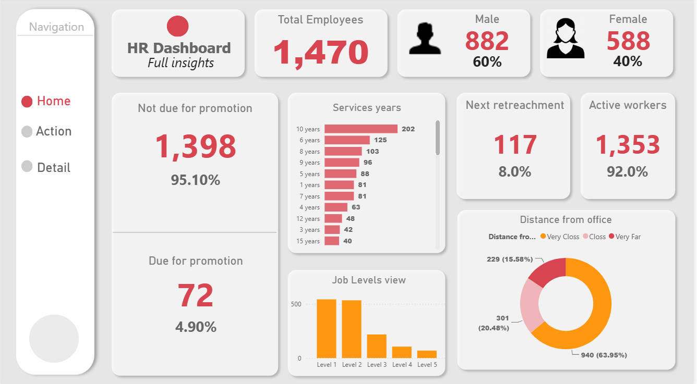
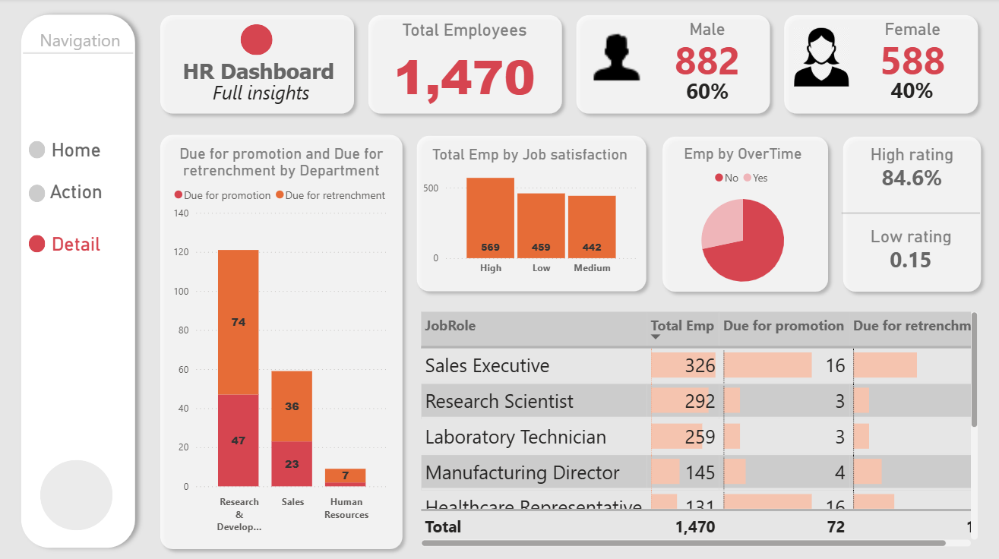
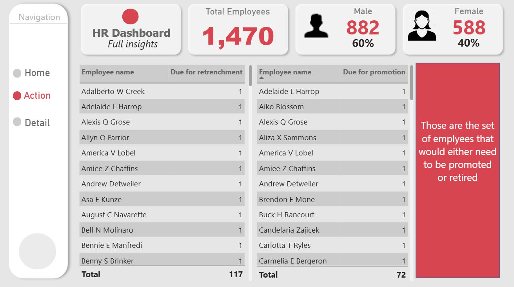

# HR Analytics Dashboard (Power BI)

An interactive, multi-page Power BI dashboard that gives HR teams a clear view of workforce composition, promotion and retirement eligibility, and employee satisfaction.

## Overview

The report turns raw employee data into KPIs and visuals so HR can quickly see who is in the workforce, who is due for promotion or retirement, and what factors (overtime, commute, satisfaction) may affect employees.

## Dashboard Pages

| Page | Purpose |
|------|---------|
| **Home** | High-level KPIs and workforce overview |
| **Details** | Deeper breakdown by department, job role, satisfaction, and overtime |
| **Action** | Employee-level lists of people due for promotion or retirement |

Pages are connected with button-based navigation (Home / Details / Action).

## Key Metrics (DAX Measures)

- Total Employees
- Male / Female count and %
- Active Workers and % Active Workers
- Due for Retirement and % Due for Retirement
- Due for Promotion / Not Due for Promotion and their %
- % High Employee Rating
- % Low Employee Rating

(15+ DAX measures in total, organized in a dedicated `All Measures` table.)

## Visuals

- **Job Levels view:** employees by job level (male, female, active, due for retirement)
- **Service Years:** employee count by total working years
- **Distance from Office:** employee distribution by commute distance
- **Department view:** promotion and retirement eligibility by department
- **Job Role table:** headcount, due for promotion, due for retirement per role
- **Job Satisfaction:** employee count by satisfaction level
- **Overtime:** employee split by overtime status
- **Action tables:** employee names due for retirement / promotion

## Data Model

| Table | Description |
|-------|-------------|
| `HR Analytics Data` | Employee attributes (job level, department, job role, working years, distance from office, satisfaction, overtime) |
| `HR employee data` | Employee names for the Action page |
| `All Measures` | DAX measures table |

## Tools Used

- Power BI Desktop
- DAX
- Power Query
- [Excel / CSV: add your source format]

## Key Insights

- [Add 2 to 3 findings, e.g. "X% of employees are due for promotion"]
- [e.g. "Employees working overtime show lower satisfaction"]
- [e.g. "Department Y has the most employees nearing retirement"]

## Screenshots

## How to Open

1. Download `Power_BI_HR_Dashboard.pbix`
2. Open it in [Power BI Desktop](https://powerbi.microsoft.com/desktop/)
3. Use the navigation buttons to move between pages

## Dataset

[Add the source of the data and whether it is sample/synthetic.]

## Author

**Tarun Chincholia**
[Portfolio](https://tarunchincholia.github.io) | [GitHub](https://github.com/tarunchincholia) | tarunchincholia@gmail.com
